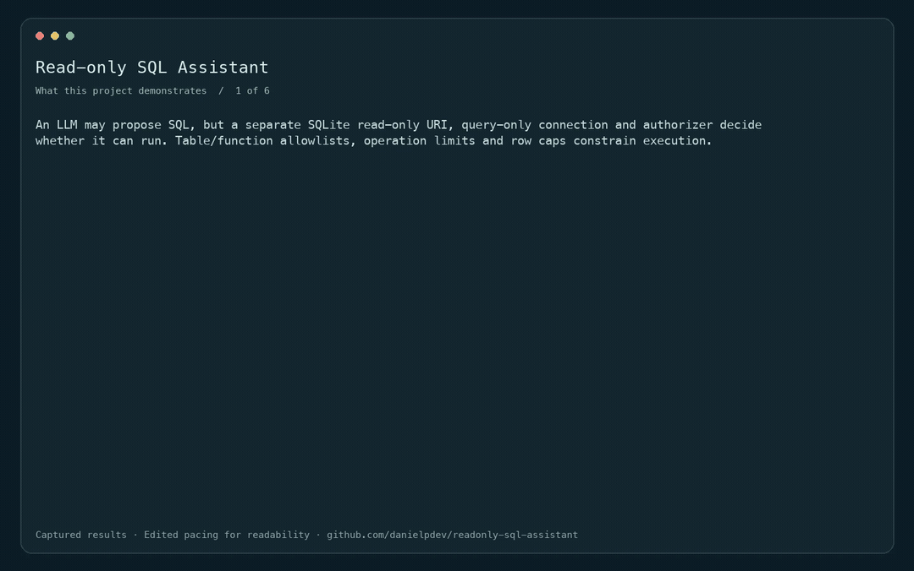
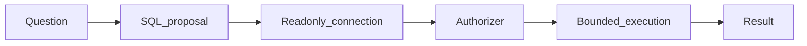

# Read-only SQL Assistant

Natural-language analytics behind a SQLite authorizer.

[](https://github.com/danielpdev/readonly-sql-assistant/actions/workflows/ci.yml)

**Role focus:** Applied AI / Data Backend. **Status:** working local portfolio implementation, with synthetic data.

## Demo



Edited replay of captured CLI outputs in deterministic fixture mode. This is not live model inference. [Full recording](docs/demo.mp4). Rebuild with `./scripts/render_gif.sh` (FFmpeg required).

## The engineering decision

An LLM may propose SQL, but a separate SQLite read-only URI, query-only connection and authorizer decide whether it can run. Table/function allowlists, operation limits and row caps constrain execution.



## Run locally

Requirements: Python 3.12, [uv](https://docs.astral.sh/uv/getting-started/installation/) and Make.

```bash
git clone https://github.com/danielpdev/readonly-sql-assistant.git
cd readonly-sql-assistant
make setup
make demo
make test
make eval
```

`make demo` uses an isolated temporary database where relevant, so it is safe to repeat. `make eval` writes a timestamped report to `reports/evaluation-fixture.json`. Fixture mode is deterministic and does not represent model inference. There is no recurring hosting or API subscription cost.

This is a CLI project; `make demo` and `make eval` are its entry points.

### Real local model mode

Install Ollama, then in a separate terminal run:

```bash
OLLAMA_HOST=127.0.0.1:11435 OLLAMA_NO_CLOUD=1 ollama serve
```

```bash
OLLAMA_HOST=127.0.0.1:11435 ollama pull qwen3:4b
make eval-local
```

The router also uses `qwen3:1.7b` as fallback; download it explicitly when running that project. No paid API key is required. First-time model/package downloads require internet and disk space. Inference runs locally. A missing model or dependency is an explicit error, never a silent fixture fallback.

[Watch the recorded demo](docs/demo.mp4) · [Reproduce the walkthrough](docs/DEMO.md)

## Verification and evidence

DELETE, DROP, ATTACH, PRAGMA, extension loading, metadata access and multiple statements are rejected. Expensive queries stop at an operation budget; results are capped.

- [Evaluation report](reports/evaluation-fixture.json) — measured during an actual run; inspect the mode and dataset size.
- [Development and authorship](docs/DEVELOPMENT.md).
- [Romanian interview preparation](docs/INTERVIEW_RO.md).
- [Design notes](docs/DESIGN.md).
- [Demo walkthrough](docs/DEMO.md).

CI uses standard GitHub-hosted runners and deterministic tests without downloading LLM weights. The lockfiles record exact package versions. Local-model results, when present, live in `reports/evaluation-local.json`; hardware/model identities are in `reports/environment.json`.

## Limits and next iteration

Only one synthetic orders table and a small function allowlist are supported. It is not a general SQL firewall for arbitrary databases. Real-model query correctness is demonstrated on one simple aggregate.

Next: Add a reviewed semantic layer, tenant row filtering and more labeled question/SQL pairs.

The local demonstration does not include production authentication, secret management or operational service guarantees. Bind it to localhost and use synthetic data. These projects demonstrate engineering decisions; they do not claim real customers, paid production deployments or guaranteed interviews.

## Project ownership

Implemented with Codex assistance for Daniel Popa. The owner should review the code, run it, make an independent change and rehearse the tradeoffs before presenting it at interview. That human understanding check is pending and cannot be verified automatically. See [development notes](docs/DEVELOPMENT.md).

MIT for original source; dependencies/models retain their own licenses. See [third-party notices](THIRD_PARTY.md).
